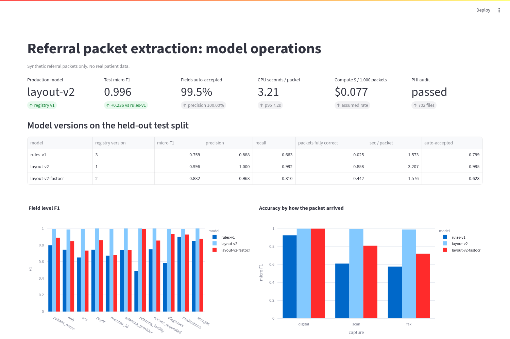
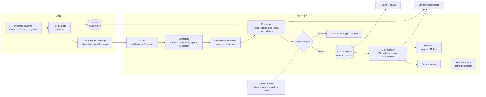
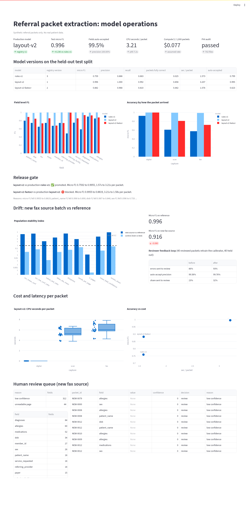
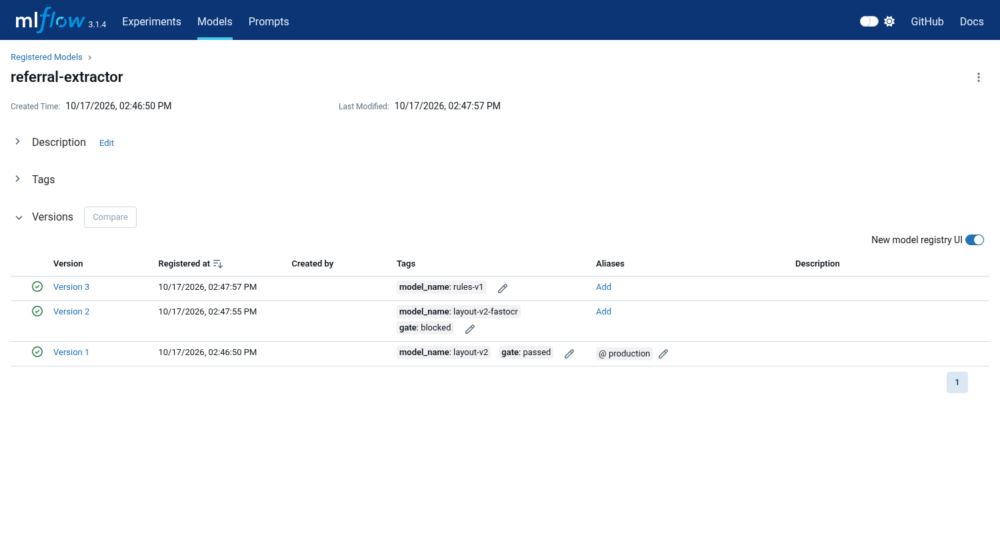
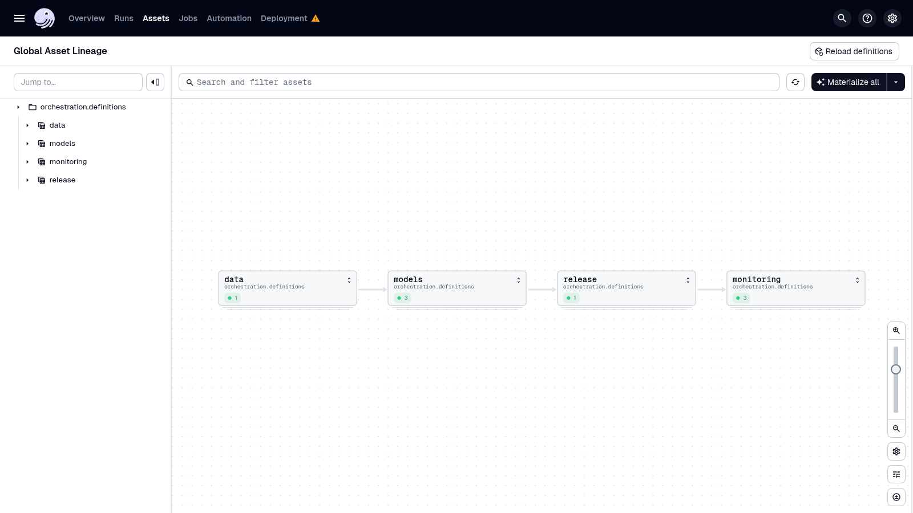

# Referral Packet MLOps Pipeline

**One line:** a production style MLOps pipeline that reads messy healthcare referral packets (digital PDFs, scans and faxes), extracts the fields an admissions team needs, and only ships a new model when it is measurably better than the one in production.

All data is synthetic. No real patient information is used anywhere.



## The problem

Post-acute care teams (skilled nursing, home health, hospice) decide whether to accept a patient from a referral packet that often arrives as a long, badly scanned fax. The patient, date of birth, diagnoses, medications, allergies, payer and requested service all have to be pulled out quickly and correctly.

Getting a model to do that once is the easy part. Running it every day is harder:

1. Is a new model or prompt actually better than production, field by field, before it ships?
2. Which values are safe to accept automatically, and which need a person to check?
3. When a new fax source sends worse scans, do we notice before the numbers go bad?
4. What does each packet cost, and how long does it take?
5. Does any patient data end up in logs or experiment tracking?

This project answers each of those with code, tests and measured numbers.

## What it does

- **Generates realistic referral packets.** 380 synthetic patients rendered in three hospital layouts (portal face sheet, discharge summary, eReferral), with fax covers, lab pages, shuffled page order and traps a real packet has: discontinued medications, "family history of stroke", "pneumonia ruled out", secondary insurance and emergency contacts. 55% are scanned or faxed with skew, blur, speckle, fax streaks and upside down pages. Every packet has an answer key.
- **Reads every page.** Native text layer for digital pages; Tesseract OCR for scans with rotation detection, a retry on unreadable orientations, deskew and denoise.
- **Extracts 11 fields** with three versioned models:
  - `rules-v1`: fixed labels and exact vocabulary lookups (the starting production model).
  - `layout-v2`: section aware extraction, OCR character repair (for example `279.4` back to `Z79.4`), ICD-10 and drug vocabulary validation, negation handling, and voting across pages, plus a trained confidence calibrator.
  - `layout-v2-fastocr`: the same extractor with the cheap OCR setup, a tempting "half the cost" change.
- **Tracks and registers every version in MLflow** with params, field level metrics, cost, the calibrator and a servable model. The `production` alias points at whatever passed the gate.
- **Release gate.** A candidate is blocked if micro F1 drops more than 0.5 points, if any single field drops more than 2 points, if it costs more without a real accuracy gain, or if p95 latency breaks the budget. The same gate runs in GitHub Actions on every push, with a negative control that must be blocked.
- **Human in the loop routing.** Each value gets a calibrated confidence. Low confidence values, values that fail a format check, values read from shaky OCR lines and any packet with an unreadable page go to a review queue.
- **Drift monitoring.** Population stability index on document features (OCR confidence, skew, sharpness, share of digital pages, words per page) and on model confidence, with a control check that must stay quiet.
- **Reviewer feedback loop.** Reviewed packets from the new source retrain the calibrator, and a held out half shows whether routing improved.
- **PHI safe logging.** A log filter redacts identifiers, the API logs only a document hash and timings, and an audit searches every log and MLflow record for any value from the answer key.
- **Serving and ops.** Dagster runs the pipeline as assets, FastAPI serves the production model straight from the registry, and Streamlit shows accuracy, gate decisions, drift, cost and the review queue.

## Architecture



## Stack

| Area | Tool | Why |
|---|---|---|
| Synthetic data | Faker, ReportLab, OpenCV, PyMuPDF | Realistic packets with no real PHI |
| OCR | Tesseract (with orientation detection) | Open source, runs anywhere |
| Extraction | Python, RapidFuzz | Section aware rules with fuzzy vocabulary repair |
| Confidence | scikit-learn logistic regression | Small, fast, explainable calibrator |
| Tracking and registry | MLflow 3 | Runs, metrics, versions and a production alias |
| Orchestration | Dagster | Assets with lineage, metadata and a daily schedule |
| Serving | FastAPI | Loads the production alias from the registry |
| Dashboard | Streamlit, Plotly | Accuracy, gate, drift, cost and review queue |
| Testing and CI | pytest, GitHub Actions | 23 tests plus the release gate on every push |
| Packaging | Docker Compose | One command to run everything |

## How to run it

```bash
docker compose up --build
```

That one command builds the image, starts MLflow, runs the full Dagster job (generate packets, OCR, train, evaluate, gate, monitor, audit) and then starts the services:

| Service | URL |
|---|---|
| Dashboard | http://localhost:8501 |
| API docs | http://localhost:8000/docs |
| MLflow | http://localhost:5000 |
| Dagster | http://localhost:3000 |

The full run took about 6 minutes on an 8 core machine. Other commands:

```bash
make test    # run the 23 tests inside the image
make gate    # the CI release gate on a fresh 40 packet batch
make audit   # PHI audit over logs and MLflow
curl -F "file=@data/packets/drift/NEW-0000.bad_fax.pdf" localhost:8000/extract
```

To try your own candidate, add a file under `configs/models/`, set it as `candidate` in `configs/release.yaml` and push. CI blocks it if it is worse than production.

## Results

All numbers below come from the Docker run on Oct 17, 2026, scored on a held out test split of 120 packets (54 digital, 37 scanned, 29 faxed). The calibrator and review threshold were fit only on the other 180 packets. Raw files are in [`results/`](results).

### Model comparison

| Model | Micro F1 | Precision | Recall | Packets fully correct | Scanned F1 | Faxed F1 | CPU sec per packet | Gate |
|---|---|---|---|---|---|---|---|---|
| rules-v1 | 0.759 | 0.888 | 0.663 | 2.5% | 0.611 | 0.576 | 1.57 | starting production |
| **layout-v2** | **0.996** | **1.000** | **0.992** | **85.8%** | **0.995** | **0.989** | 3.21 | **promoted** |
| layout-v2-fastocr | 0.882 | 0.968 | 0.810 | 44.2% | 0.810 | 0.720 | 1.58 | **blocked** |

Field level F1 for `layout-v2`: patient name 0.996, DOB 0.987, sex 0.996, payer 1.000, member ID 0.992, referring provider 1.000, referring facility 1.000, service requested 1.000, diagnoses 0.995, medications 0.993, allergies 1.000.

### Release gate

- `layout-v2` vs `rules-v1`: **passed**. It costs about twice the CPU time, but micro F1 rose by 23.6 points, which clears the "pay more only for a real gain" rule.
- `layout-v2-fastocr` vs `layout-v2`: **blocked**. It halves OCR time, but micro F1 fell from 0.996 to 0.882 and 10 of 11 fields regressed (member ID 0.992 to 0.679, sex 0.996 to 0.733). Nothing broke on digital packets (0.999), so a test set without scans would have shipped it.

### Cost and latency (production model)

- 3.21 CPU seconds per packet on average, p50 4.3 s, p95 7.2 s. Digital packets take 0.01 s; scans 5.5 s and faxes 6.2 s, so OCR is almost the whole cost.
- About $0.08 of compute per 1,000 packets at an assumed $0.000024 per CPU second (set your own rate in `configs/pipeline.yaml`).

### Human review

- On the standard test split, 99.5% of values were auto-accepted at 100% precision. The 0.5% sent to review contained every wrong value.
- On the new fax source batch (80 packets), 21% of values went to review, auto-accepted values were 99.1% precise, and the review queue caught 64% of the wrong values. That gap is what the feedback loop fixes.

### Drift and the feedback loop

A batch of 80 packets from a new, low quality fax source (80% bad faxes, 150 dpi, heavy blur and turned pages):

| Signal | Reference | New source | PSI |
|---|---|---|---|
| Mean OCR confidence | 96.3 | 82.8 | 3.15 |
| Share of low confidence words | 1.1% | 15.4% | 3.58 |
| Share of digital pages | 45% | 12.5% | 0.57 |
| Mean skew (degrees) | 0.62 | 1.44 | 1.40 |
| Share of values sent to review | 0.5% | 20.3% | 4.91 |

- 8 of 9 monitored signals crossed the 0.2 alert line. The control check (training packets vs test packets from the same source) raised **no** alerts, so the alarm is not noise.
- The alert matched a real accuracy drop: micro F1 went from 0.996 to 0.916 on the new source.
- **Feedback loop:** reviewers' corrections on 40 of those packets retrained the calibrator. On the other 40 held out packets, the share of wrong values caught by review rose from 86% to 93% and auto-accept precision rose from 99.58% to 99.76%, at the cost of reviewing 32% of values instead of 23%.

### Privacy

The PHI audit searched 702 log and MLflow files for 1,511 patient values (names, dates of birth, member IDs) from the answer key and found **0 leaks**. The API test proves the same for served requests.

### Screenshots

| Dashboard (full) | MLflow registry | Dagster lineage |
|---|---|---|
|  |  |  |

## Final verdict

The pipeline does what a production ML team needs before it trusts a model with admissions decisions. It measures every field, it caught a cheaper model that looked fine on clean PDFs but broke on faxes, it flagged a bad new fax source with no false alarm on normal traffic, and it keeps patient data out of logs.

Honest limits:

- The 0.996 F1 is on synthetic packets from three layouts I designed, so it says more about the pipeline than about real world accuracy. Real packets have handwriting, more layouts and far more noise. The gaps between models, and the drop on the bad fax source, are the meaningful numbers.
- On the bad fax batch some pages are close to unreadable, and recall drops (medications 0.885, member ID 0.852). Those packets go to review rather than being guessed.
- Extraction here is rule based with a learned calibrator, not a large language model. A model API was not available for this build. The gate, registry, drift and review layers work the same for any extractor, so an LLM or a fine tuned model plugs in as one more config under `configs/models/`.

## Project structure

```
.
├── configs/
│   ├── models/              # one YAML per model version
│   ├── pipeline.yaml        # data size, gate rules, review policy, drift, cost
│   └── release.yaml         # production and candidate for CI
├── src/referral_mlops/
│   ├── synth/               # synthetic patients, PDF layouts, scan and fax damage
│   ├── extract/             # rules-v1, layout-v2 and shared normalizers
│   ├── ocr.py               # text layer or Tesseract with rotation, deskew, denoise
│   ├── evaluate.py          # field level precision and recall
│   ├── calibrate.py         # confidence calibrator
│   ├── review.py            # human in the loop routing
│   ├── drift.py             # population stability index
│   ├── phi.py               # log redaction and PHI audit
│   ├── tracking.py          # MLflow runs, registry and serving wrapper
│   ├── gate.py              # CI release gate
│   ├── pipeline.py          # all steps
│   └── api/main.py          # FastAPI service
├── orchestration/definitions.py   # Dagster assets, job and schedule
├── dashboard/app.py         # Streamlit dashboard
├── tests/                   # 23 pytest tests
├── results/                 # measured results from the last run
├── docs/img/                # screenshots
├── .github/workflows/ci.yml
├── docker-compose.yml
├── Dockerfile
└── Makefile
```

## Author

**Manish Reddy**, Data Engineer (Google Cloud certified Professional Data Engineer), Toronto

- Email: manishreddyr998@gmail.com
- LinkedIn: https://www.linkedin.com/in/manish-re-50c02a719k/
- GitHub: [manishreddy998](https://github.com/manishreddy998)

## License

MIT, see [LICENSE](LICENSE).
